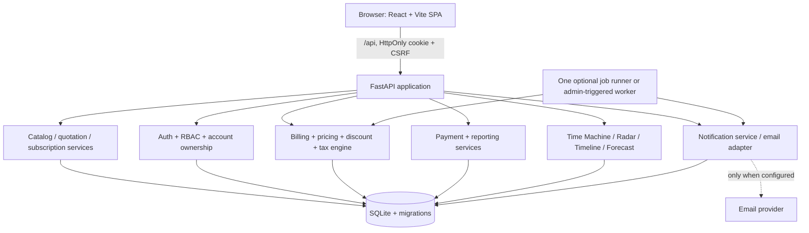

# Billora — Technical Architecture & Integration Contract

> **Product:** Billora — Intelligent Subscription, Billing & Revenue Automation Platform  
> **Demo business:** Brightloop Software (the fictional company in the official problem statement)  
> **Version:** 1.0 / hackathon baseline  
> **Status:** Proposed implementation contract; assumptions and release gates are explicit  
> **Audience:** Abhishikth (frontend/integration), Adithya (backend/data), Abiya (admin/staff features)  
> **Build window:** 9:00 AM–5:00 PM IST, eight-hour virtual round  
> **Related files:** `PRD.md` (functional scope), `DESIGN.md` (visual/interaction system)

---

## 0. Authority, priorities and how to use this file

This is the **technical source of truth** for the repository. It translates the project requirements into code boundaries, storage rules, API contracts, workflows, transaction guarantees and delivery order.

**Conflict resolution:** (1) the organizer's actual problem statement and portal rules control the competition; (2) `PRD.md` controls the product behavior and priority; (3) this document controls the architecture/API/data invariants; (4) `DESIGN.md` controls UI design, accessibility, states, and components. Record deliberate changes in `docs/DECISIONS.md`, update tests/contracts, and tell the other two developers before modifying shared interfaces.

- **P0 — mandatory:** Auth/roles/reset; catalog/variants/plans/taxes/discounts; quotations/templates; complete subscription lifecycle; recurring invoices, payments and reports; input validation; reasonable performance.
- **P1 — differentiation:** Time Machine, Revenue Leak Radar, Explain My Bill, renewal reminders, email invoice alerts, Activity Timeline.
- **P2 — after stable core:** Revenue Forecast, consolidated invoicing, plan switching, smart CSV migration.
- **P3 — stretch:** Enterprise parent/child accounts, seat/usage tracking, WhatsApp delivery.
- A feature is **not complete** because a page renders. It is complete when its authorized backend behavior, persistent data, loading/error states, and acceptance test work.
- Never describe mocks, email previews, simulated money or future projections as real processing/delivery.

**Organizer-specific repository rule:** Use a public GitHub repository and one shared `main` branch with each person's own commits pushed at least hourly (aim every 20–30 minutes). The team leader must submit the repository URL before 10:00 AM; the most recent code must be on `main`. Avoid overlapping edits on shared files.

## 1. Decisions at a glance

| Concern | Chosen baseline | Rationale / constraint |
|---|---|---|
| Repository | Single monorepo, one shared `main` | Organizer's single-branch guidance; same app, independently owned directories |
| Frontend | React + Vite + TypeScript | Parallel modules, fast builds, typed service calls |
| UI | Tailwind CSS, reusable accessible components, Lucide, Recharts if installed | Follow `DESIGN.md` (original Billora identity, Stripe × Linear inspiration) |
| Backend | Python FastAPI + Pydantic + SQLAlchemy 2.x | OpenAPI, validation, clear service layer |
| Persistence | SQLite for hackathon, WAL, FK enforcement, migrations | No separate DB server; index and measure 5,000 subscriptions |
| Authentication | Server-side session, HttpOnly cookie, CSRF protection | No sensitive access tokens in browser localStorage |
| Passwords | Proven password-hashing algorithm (Argon2id preferred) | No plaintext or custom crypto |
| API | Same-origin `/api`, JSON; `/api/v1` may be introduced later by coordinated change | Avoid cross-origin auth trouble; one stable typed contract |
| Dates | Business dates in `Asia/Kolkata`; timestamps stored UTC | Stable renewal logic and demo boundaries |
| Money | Integer INR minor units (paise) + explicit `currency` | No floating-point finance errors; future currency fields are optional |
| Jobs | Core pure service + manually invoked admin job; **single** scheduler process optional | No duplicate in-process schedulers in hot reload / multiworker setups |
| External delivery | Email adapter (real configured transport or visibly labeled preview) | Password reset requires an actual email for real delivery claim |
| Payment | Record offline/manual payments, no gateway | Matches original statement; no PCI processing |
| Dev/runtime | Vite proxy `/api` → FastAPI; local SQLite on backend only | Single shared backend DB for team integration |
| Testing | Pytest + FastAPI TestClient, Vitest where feasible, manual E2E script | Guard financial correctness and user isolation |

**Stack fallback:** If Adithya is markedly more productive with Node/Express, change this table *once*, before scaffolding, and translate the same contracts into that stack. Do not maintain two backends.

### 1.1 Explicitly excluded from baseline

No microservices, Redis, Celery, Kafka, production cloud infrastructure, live card collection, generic AI chatbot, ML predictions, or multi-currency accounting. Do not add Docker as a hard prerequisite. External provider approvals must not gate the local demo.

### 1.2 Architecture principles

1. **One billing calculation path.** Manual run, scheduled run, Time Machine preview, invoice explanation and forecast call shared calculation primitives; previews never write.
2. **Server is authoritative.** Enforce role, ownership, lifecycle, eligibility, price, tax, and totals server-side.
3. **Transactional financial writes.** An invoice, its billing-cycle reservations, invoice lines, and schedule advancement succeed or fail together.
4. **Idempotent effects.** Replayed job/payment/notification requests do not duplicate real-world outcomes.
5. **Snapshots over retroactive edits.** Confirmed invoice totals and historical line pricing remain unchanged after catalog updates.
6. **One file owner per integration boundary.** API, schemas, router, lockfile, tokens and migrations are coordinated changes.
7. **Measurable > claimed.** Report real collected payments separately from invoiced totals and forecast billings.

## 2. System overview



**Request path:** React view → feature API hook/client → typed HTTP request → auth/permissions dependency → router/Pydantic validation → application service → SQLAlchemy transaction → SQLite → normalized API response. Real-time in the brief means **fresh, dynamic persisted information**; no WebSocket requirement. Refreshing lists after confirmed changes or polling busy job status is acceptable.

**Integration:** Each developer runs their own frontend dev server as needed but points it to the same agreed backend/API. If developing on different laptops, each may use a **local DB fixture** and the same seeded migration version. Never share a live SQLite file through Git or cloud-sync; integration happens through Git source, seed scripts and API contracts. For a shared staging server, only its backend process accesses its SQLite file.

## 3. Repository layout and ownership

```text
billora/
├── PRD.md                       # Team-reviewed functional contract
├── DESIGN.md                    # Abhishikth owns final visual tokens/shell
├── ARCHITECTURE.md              # Team-reviewed technical contract
├── README.md                    # Start, seed, demo, test, limitations
├── .gitignore
├── .env.example                 # Names/examples only; never secrets
├── contracts/
│   ├── api-types.ts             # Coordinated TypeScript contract
│   ├── enums.ts                 # Coordinated status/role values
│   └── examples/                # Request/response example fixtures
├── frontend/
│   ├── package.json
│   ├── vite.config.ts
│   ├── src/
│   │   ├── app/                 # Abhishikth: routing, providers, shell
│   │   ├── styles/              # Abhishikth: Billora tokens, globals
│   │   ├── components/ui/       # Abhishikth: shared accessible UI
│   │   ├── components/data/     # Abhishikth: tables/KPIs/charts
│   │   ├── lib/api/             # Abhishikth: one fetch client/auth/CSRF
│   │   ├── lib/format/          # Abhishikth: money/date/status formatting
│   │   ├── features/auth/       # Abhishikth
│   │   ├── features/customer/   # Abhishikth
│   │   ├── features/subscriptions/ # Abhishikth
│   │   ├── features/billing/    # Abhishikth: invoices/payments/Time Machine
│   │   ├── features/dashboard/  # Abhishikth: reports
│   │   ├── features/forecast/   # Abhishikth: P2
│   │   ├── features/admin/      # Abiya: products/plans/taxes/discounts
│   │   ├── features/quotations/ # Abiya: templates/offers
│   │   ├── features/revenue-radar/ # Abiya
│   │   ├── features/activity/   # Abiya
│   │   ├── features/notifications/ # Abiya
│   │   ├── features/import/     # Abiya: P2
│   │   └── features/enterprise/ # Abiya: P3
│   └── tests/
├── backend/                     # Adithya owns all backend code
│   ├── app/
│   │   ├── main.py
│   │   ├── core/{config,security,clock,db}.py
│   │   ├── api/{deps,auth,staff,catalog,quotes,subscriptions,invoices,payments,reports,billing,insights,notifications}.py
│   │   ├── models/             # SQLAlchemy entities + constraints
│   │   ├── schemas/            # Pydantic DTOs: never expose ORM directly
│   │   ├── repositories/       # Scoped database queries
│   │   ├── services/           # Business logic and transaction boundaries
│   │   │   ├── pricing.py
│   │   │   ├── billing.py
│   │   │   ├── dates.py
│   │   │   ├── discounts.py
│   │   │   ├── subscriptions.py
│   │   │   ├── payments.py
│   │   │   ├── notifications.py
│   │   │   └── reporting.py
│   │   ├── jobs/               # Optional single-scheduler entry point
│   │   └── adapters/email.py   # Real or preview adapter
│   ├── alembic/                # Migrations
│   ├── scripts/seed_demo.py
│   ├── scripts/seed_performance.py
│   ├── tests/{unit,integration}/
│   └── requirements.txt or pyproject.toml
└── docs/
    ├── DECISIONS.md
    ├── API_EXAMPLES.md
    └── DEMO_CHECKLIST.md
```

Keep the actual generated file layout if already scaffolded; adapt examples rather than rewriting teammates' work just to match this tree. Use **feature modules** that export named React screens; Abhishikth alone wires them into the central router. Abiya may create standalone hooks/components inside her own feature folders without touching `app/`, `components/ui/`, global CSS or lockfiles.

### 3.1 Module contract freeze

By the first integration checkpoint, agree on:

- Role enum: `ADMIN | STAFF | CUSTOMER`.
- Subscription status: `DRAFT | QUOTATION | CONFIRMED | ACTIVE | PAUSED | CLOSED` (`PAUSED` is our explicit internal implementation choice).
- Invoice status: `DRAFT | CONFIRMED | PAID | CANCELLED` (`PARTIALLY_PAID` and `OVERDUE` are derived display labels).
- Billing interval: `DAILY | WEEKLY | MONTHLY | YEARLY`.
- Money fields ending `_minor` (integers) with `currency` (default `INR`).
- API list envelope, error envelope and route names from §7.
- Date strings as `YYYY-MM-DD`, timestamps as ISO 8601 UTC.

**Breaking-change protocol:** Backend owner announces proposed change → frontend owners approve impact → `contracts/` updated by the designated owner → frontend fixtures updated → backend/frontend tests pass → commits pushed. Do not have multiple agents rewrite `contracts/api-types.ts` simultaneously.

## 4. Data model and persistence

### 4.1 Conventions

- Table names `snake_case` plural, columns `snake_case`, SQLAlchemy models singular PascalCase.
- Public primary keys: UUIDv4 strings (`TEXT` in SQLite); human-friendly references: `SUB-000001`, `INV-000001`, `QUO-000001` generated under a transaction using a `reference_counters` table, or another concurrency-safe sequence.
- All foreign keys are enforced: enable SQLite `PRAGMA foreign_keys=ON` **on every connection**, not only once at startup.
- Where possible, store `created_at`/`updated_at` timestamps in UTC, renewal/expiry as `DATE` in business timezone.
- All money: signed 64-bit **integer minor units** with explicit currency, nonnegative for normal prices and totals. Represent negative adjustments with a specifically named signed adjustment field, never an accidentally negative price.
- Tax rates: integer basis points (e.g., 18% → 1800 basis points), applied using Decimal calculations and one documented rounding strategy.
- Use immutable invoice line snapshots, even if source product/plan/discount rows are later edited or deactivated.
- Use `active` flags for mutable catalog records; don't cascade-delete objects referenced by invoices.
- Add `version` or updated-at conditional checks on high-risk edited records if time allows; return 409 for stale edits.

### 4.2 Core entities (P0)

The fields below are **minimum architecture**, not a requirement to implement a full enterprise schema before the first vertical slice.

| Table | Key fields / relationships | Constraints and notes |
|---|---|---|
| `accounts` | `id`, `display_name`, `billing_email`, `billing_address`, `currency`, `parent_account_id?` | One account bills one or more subscriptions; parent is P3 and nullable |
| `users` | `id`, `account_id?`, `email_normalized`, `password_hash`, `role`, `is_active`, `created_at` | UNIQUE normalized email; staff need not have customer account; no password in response |
| `user_sessions` | `id`, `user_id`, `session_token_hash`, `csrf_token_hash`, `expires_at`, `revoked_at?` | Session cookie contains opaque random token, DB only hash; logout revokes |
| `password_reset_tokens` | `id`, `user_id`, `token_hash`, `expires_at`, `consumed_at?` | One-time use, TTL, neutral request response |
| `products` | `id`, `name`, `type`, `sales_price_minor`, `cost_price_minor`, `notes`, `active` | Sale price/cost >=0; currency explicit if not default |
| `product_variants` | `id`, `product_id`, `attribute_name`, `attribute_value`, `price_delta_minor`, `active` | Demo `brand=Odoo` adjusts price by +560 major INR units (=56,000 minor) |
| `plans` | `id`, `name`, `base_fee_minor`, `bill_plan_base_fee`, `billing_interval`, `min_quantity`, `available_from`, `available_to?`, `auto_close`, `can_pause`, `can_renew`, `can_close_early`, `active` | Quantity >=1; dates valid; plan fee charged only when explicitly enabled per invoice price builder |
| `tax_rules` | `id`, `name`, `rate_bps`, `scope`, `product_id?`, `effective_from/to?`, `active` | `0 <= rate_bps <= 10000` initially; source rule identified on snapshot |
| `discount_rules` | `id`, `name`, `kind`, `value_minor?`, `percent_bps?`, `min_quantity?`, `min_purchase_minor?`, `starts_on/ends_on?`, `max_uses?`, `uses_count`, `scope`, `product_id?`, `priority`, `active` | Admin-only; `kind=FIXED|PERCENT`; one matching value field; no negative savings |
| `discount_redemptions` | `id`, `rule_id`, `invoice_id`, `applied_minor`, `redeemed_at` | UNIQUE `(rule_id,invoice_id)`; consume only when invoice is finalized/confirmed |
| `quotation_templates` | `id`, `name`, `plan_id`, `validity_days`, `active`, `created_by` | `validity_days > 0` |
| `quotation_template_lines` | `id`, `template_id`, `product_id`, `variant_id?`, `quantity`, `unit_price_minor?`, `tax_rule_id?` | Snapshot into an individual quotation on creation |
| `quotations` | `id`, `number`, `subscription_id`, `account_id`, `issued_on`, `valid_until`, `status`, `terms`, `created_by` | One current quote per subscription in MVP; quote status `ISSUED|ACCEPTED|EXPIRED|CANCELLED` |
| `quotation_lines` | `id`, `quotation_id`, `source_product_id`, `variant_id?`, `quantity`, `unit_price_minor`, `description`, `tax_rule_id?` | Quote snapshot not editable after acceptance |
| `subscriptions` | `id`, `number`, `account_id`, `plan_id`, `status`, `start_date`, `expiry_date?`, `payment_term_days`, `next_billing_date`, `billing_anchor_day?`, `billing_anchor_eom`, `paused_at?`, `created_at` | UNIQUE number; billing begins only in ACTIVE state |
| `subscription_lines` | `id`, `subscription_id`, `product_id`, `variant_id?`, `description`, `quantity`, `unit_price_minor`, `tax_rule_id?`, `billable` | Quantity >0; price/variant snapshot from agreement; do not silently reprice active contracts |
| `billing_cycles` | `id`, `subscription_id`, `period_start`, `period_end_exclusive`, `invoice_id?`, `created_at` | UNIQUE `(subscription_id, period_start, period_end_exclusive)`; source of truth for processed cycles |
| `invoices` | `id`, `number`, `billing_account_id`, `issued_on`, `due_on`, `status`, `currency`, `subtotal_minor`, `discount_minor`, `tax_minor`, `total_minor`, `paid_minor`, `confirmed_at?`, `sent_at?` | No mandatory `subscription_id` FK: future consolidation needs many source subscriptions |
| `invoice_lines` | `id`, `invoice_id`, `source_subscription_id`, `source_subscription_line_id?`, `description`, `quantity`, `unit_price_minor`, `line_subtotal_minor`, `discount_minor`, `tax_bps`, `tax_minor`, `total_minor`, `source_rule_id?` | Frozen snapshot; all prices independently explainable |
| `payments` | `id`, `invoice_id`, `method`, `amount_minor`, `paid_at`, `note`, `recorded_by`, `external_ref?` | Amount >0; payment to confirmed collectible invoice, no overpay; idempotency guard |
| `audit_events` | `id`, `account_id?`, `entity_type`, `entity_id`, `event_type`, `actor_user_id?`, `actor_kind`, `summary_json`, `created_at` | Immutable append-only; no sensitive tokens in payload |
| `idempotency_records` | `id`, `scope`, `principal_key`, `request_key`, `request_hash`, `response_json`, `created_at` | UNIQUE `(scope,principal_key,request_key)`; `principal_key` is non-null to avoid SQLite NULL-uniqueness loopholes; reject changed payload |
| `reference_counters` | `name`, `next_value` | Transactional issuance of human readable numbers |

**Product/plan pricing decision:** In MVP, `plans.base_fee_minor` is an explicit recurring base-fee line **when enabled**, while `subscription_lines` represent individually billable products/add-ons. The subscription/quotation form must display the exact combined charges before confirmation. Never implicitly charge the plan fee *and* repeat the same product cost; if a plan fee is merely a display price, configure `bill_plan_base_fee=false` or equivalent. The PRD permits this interpretation as an assumption.

**Account ownership:** A `CUSTOMER` user's `account_id` defines the billing account whose subscriptions/invoices they may see; `STAFF`/`ADMIN` operational privileges are separate. P3 parent visibility is an explicit authorization path, not an assumption that any matching parent ID grants edit rights.

### 4.3 Extension entities (add only when the feature ships)

| Priority | Table | Essential fields and invariant |
|---|---|---|
| P1 | `notifications` | `subscription_id?`, `invoice_id?`, `account_id`, `channel`, `kind`, `cycle_key`, `dedupe_key`, `status`, `attempts`, `last_error?`, `sent_at?`; UNIQUE non-null `dedupe_key` for each intended event |
| P1 | `notification_preferences` | `account_id`, `email_enabled`, `whatsapp_opt_in`; default documented |
| P2 | `pending_plan_changes` | `subscription_id`, `target_plan_id`, `target_quantity`, `effective_on`, `requested_by`, `status`, `applied_at?`; one pending request per subscription |
| P2 | `import_jobs` / `import_rows` | uploader, entity type, fingerprint/file checksum, status, row index, field map, validation errors; dry run does not write domain entities |
| P3 | `seat_assignments` | subscription, seat/user reference, active, assigned_at; uniqueness to prevent double-counted seats |
| P3 | `account_memberships` | parent manager user, child account, explicit `can_view_billing` permission (if hierarchy enabled) |

### 4.4 Critical indexes

```sql
CREATE INDEX ix_subscriptions_due ON subscriptions (status, next_billing_date);
CREATE INDEX ix_subscriptions_account ON subscriptions (account_id, status);
CREATE UNIQUE INDEX ux_cycles_one_per_period
  ON billing_cycles (subscription_id, period_start, period_end_exclusive);
CREATE INDEX ix_invoices_due ON invoices (status, due_on);
CREATE INDEX ix_invoices_account ON invoices (billing_account_id, issued_on);
CREATE INDEX ix_payments_invoice_date ON payments (invoice_id, paid_at);
CREATE INDEX ix_events_entity_time ON audit_events (entity_type, entity_id, created_at);
CREATE INDEX ix_products_active_name ON products (active, name);
```

Enforce any required UNIQUE/FOREIGN KEY/CHECK constraints in migrations, not just in this illustrative index block. For `discount_redemptions`, `uses_count` must be incremented in the same transaction and verified against `max_uses`.

### 4.5 SQLite operational guardrails

- Configure `PRAGMA foreign_keys=ON`, `PRAGMA journal_mode=WAL`, and `busy_timeout` (for example 5000 ms). Keep one request-scoped DB session; do not share a SQLAlchemy session across threads.
- Use short write transactions. For competing billing/payment writers, SQLite has a single writer: acquire a write reservation (`BEGIN IMMEDIATE`) **before** reading and advancing cycle state when the transaction requires serialization, or use an equivalent correctly tested coordination mechanism.
- Do not run `uvicorn --workers 4` or multiple in-process schedulers against one local SQLite file in the hackathon baseline. Run one backend worker and one job runner at most.
- An Alembic migration runs on start/setup, and a seed script generates deterministic demo records. Never make ordinary API startup delete/reseed the DB.
- Ignore `*.db`, `*.db-wal`, `*.db-shm`, `.env`, local uploads, provider keys, `.venv`, and build caches in `.gitignore`.
- If strong concurrent write load is essential, migrate to PostgreSQL instead of pretending SQLite is a multi-writer server. The public API and model contracts need not change.

## 5. Business invariants and state machines

### 5.1 Subscriptions and quotations

```text
DRAFT → QUOTATION → CONFIRMED → ACTIVE → CLOSED
                            ACTIVE ↔ PAUSED  (if plan permits)
                            ACTIVE → ACTIVE (renewal extends terms, logged event)
```

**Canonical subscription status** lives on `subscriptions.status`. A `quotations` row provides the offer snapshot and validity, not a second contradictory source for subscription activation. Creating an offer from a template creates/updates its linked DRAFT subscription to `QUOTATION` in one transaction; accepting it sets `CONFIRMED`; authorized activation sets `ACTIVE`, with `next_billing_date` initialized. Quote expiration blocks acceptance until reissued. Only allowed plan policies permit pause, resume, early close and renewal. A closed subscription never generates a new cycle. Document whether a resumed subscription preserves the original calendar anchor (chosen baseline: yes; no catch-up billing for fully paused periods).

**Authorization:** Admin/staff control internal quote/subscription transitions. Customer may view own agreements and request changes only where P2 self-service policy explicitly allows it. Server checks transition state, expiry, plan rules and caller authorization.

### 5.2 Invoices and payments

```text
DRAFT → CONFIRMED → PAID
  └────→ CANCELLED ←─ CONFIRMED (only if no payment recorded)
```

- `send` and `print` are **actions**, not invoice financial statuses. `OVERDUE` and `PARTIALLY_PAID` are computed labels on `CONFIRMED` invoices.
- Billing job creates **DRAFT** invoice with itemized draft calculation snapshots and associated cycle(s); the authorized confirm action validates/finalizes amounts and consumes limited discount redemptions **once**.
- After CONFIRMED, invoice line amounts are immutable; it cannot be edited in place to change financial history.
- Invoice cancellation does **not** delete the processed `billing_cycles` row or automatically create a replacement invoice for the same period. Corrections/reissues require an explicit controlled process, not replaying the scheduler. Only unpaid draft/confirmed invoices may be cancelled in baseline.
- Payments can only be posted to collectible CONFIRMED invoices. `paid_minor` is the sum of non-reversed recorded payments. `PAID` when `paid_minor == total_minor`, no oversettlement.
- If the invoice is consolidated, its lines/cycles still reference all source subscriptions; the payment reduces the **invoice** balance, not one arbitrary source subscription.

### 5.3 Discount lifecycle and finalization

Previews and draft calculations read eligible rule definitions but **do not** increment usage counters. At invoice confirmation, transactionally re-check current time/quantity/amount/rule usage, settle discounts into final snapshot lines, insert `discount_redemptions`, and increment each affected rule's `uses_count` exactly once. If the rule exhausted between draft and confirmation, recalculate draft totals and require explicit review before confirmation (409 with changed quote summary) rather than silently changing a financial amount the user expected. The confirm request must include an expected draft revision/total so the server can detect and return this conflict.

This is a deliberate choice to reconcile **DRAFT → CONFIRMED** with the PRD's “consume use once when finalized” rule. An auto-confirm extension may create and confirm in one transaction by calling the same finalization service; do not implement a separate discount path.

### 5.4 Example money calculation

For a billable product line:

```text
unit_minor = agreed_base_unit_minor + agreed_variant_delta_minor
subtotal_minor = unit_minor × quantity
eligible_discount_minor = min(deterministic_rule_saving, subtotal_minor)
taxable_minor = subtotal_minor − eligible_discount_minor
tax_minor = round_half_up(taxable_minor × rate_bps / 10_000)
line_total_minor = taxable_minor + tax_minor
invoice_total_minor = sum(line_total_minor of all frozen invoice lines)
```

Use `Decimal(...).quantize(Decimal('1'), rounding=ROUND_HALF_UP)` or tested equivalent integer math at **one declared rounding stage per line**. Show `subtotal_minor`, `discount_minor`, `tax_minor`, `total_minor` in every invoice response. Never accept client-provided totals. Subscription-wide fixed/percentage savings are deterministically allocated to eligible lines using a documented remainder rule so taxes and subtotals reconcile exactly.

**Discount selection (baseline):** Eligible product-scope rules and eligible subscription-scope rules do not each stack multiple rules in the same scope. Choose highest priority, then largest valid saving, then stable ID. Enforce minimum purchase/quantity, active date window, allowed product scope, and maximum usages. For example quantity tiers `>=10`, `>=25`, `>=50` are separate admin rules; the selector picks exactly one applicable rule per configured scope.

### 5.5 Calendar billing and expiry

- Store billing timezone `Asia/Kolkata`, date-only due boundary, and original anchor day / end-of-month flag.
- Daily: +1 calendar day; weekly: +7; monthly/yearly: same anchor day adjusted to month-end, **without drift** (Jan 31 → Feb 28 → Mar 31 for an ordinary year).
- `period_start` = current due date; `period_end_exclusive` = next anchor-derived date. Use half-open periods `[start, end)` everywhere.
- If `expiry_date` ends a subscription, do not create a cycle starting after expiry; avoid automatic proration of a partial final period unless explicitly implemented. Auto-close only when the plan's `auto_close` policy says so.
- A paused subscription is skipped; resume preserves anchor and schedules the **first future eligible** cycle, without retroactive charges for the paused interval. Make this explicit in UI.
- Missed *active* cycles due to app downtime are backfilled sequentially, limited by an explicit configurable maximum per run with visible remaining-work count; never silently jump the date ahead.
- Billing terms: default `due_on = issued_on + payment_term_days`; include timezone and date boundaries in tests.

---
## 6. Core service interfaces and automated processing

### 6.1 Service boundaries

| Service | Responsible for | May call | Must not do |
|---|---|---|---|
| `AuthService` | Registration, sessions, reset links, role checks | User/session repo, notification queue | Return password hashes or enumerate reset emails |
| `CatalogService` | Products, variants, plans, taxes and rule CRUD | Catalog repositories | Edit historical invoice snapshots |
| `QuotationService` | Template cloning, quotation validity, quote confirmation | Pricing preview, subscription service | Bypass plan availability and permissions |
| `SubscriptionService` | Lifecycle transitions, pause/close/renew, pending plan change | Plan rules, audit events | Directly generate an invoice via UI-specific code |
| `PricingService` | Itemized calculation, discount/tax allocation, frozen snapshot inputs | Read-only catalog/rules | Send email, mutate data in preview mode |
| `BillingService` | Due-cycle selection, cycle dedupe, transactional invoice creation, next due date | Pricing, subscription calendar, audit | Keep a DB transaction open while emailing |
| `InvoiceService` | Confirm, cancel, printable representation, send request | Pricing finalization, notification queue | Allow paid invoice cancellation without reversal |
| `PaymentService` | Invoice payments and balance/status change | Payments, invoice repo, audit | Trust amount owed from browser |
| `ReportingService` | Summary, overdue lists, invoiced vs collected totals | Indexed DB queries | Mistake projected billing for collected cash |
| `InsightsService` | Time Machine, Radar, forecast, timeline | Read-only billing calculator/reporting | Change live records during preview |
| `NotificationService` | In-app events, dedupe, provider queue, send attempts | Email adapter, notification repo | Set invoice to paid or claim false send success |
| `ImportService` (P2) | CSV preview, mapping, validation, commit | Domain services | Write on validation-only request |

**Transaction ownership:** API routers parse and authorize; a service owns the transactional unit. Repositories should not commit independently. `audit_events` relating to financial changes must be inserted in the same transaction as the change; outbound notifications happen **after commit**, with durable queued records if feature enabled.

### 6.2 Due-invoice run: reference algorithm

```python
# Precise pseudocode, not drop-in code; implementation owned by Adithya.
def run_due_billing(effective_date, actor, mode="execute"):
    require_role(actor, "ADMIN") if mode == "execute" else require_ops_access(actor)
    if mode == "preview":
        return plan_cycles_read_only(effective_date)  # no flush/commit/events/email

    result = BillingRunSummary()
    while next_eligible_cycle_exists(effective_date, limit=MAX_CYCLES_PER_RUN):
        # Short SERIALIZED SQLite write transaction; retries handled by uniqueness.
        with serialized_write_transaction() as tx:
            sub = load_next_due_subscription_and_revalidate(tx, effective_date)
            if sub is None:
                break
            period = compute_next_half_open_period(sub)
            if cycle_already_processed(sub.id, period):
                reconcile_next_due_if_needed(sub)
                result.already_processed += 1
                continue
            snapshot = PricingService.calculate(sub, period.start, preview=True)
            inv = create_draft_invoice(snapshot, billing_account=sub.account_id)
            attach_billing_cycle(sub, period, inv)
            sub.next_billing_date = period.end
            record_event("INVOICE_GENERATED", actor_kind="SYSTEM", entity_id=inv.id)
        result.created_invoices += 1

    return result
```

**Critical notes:**

1. In SQLAlchemy, arrange transaction locking **before the due-row read**; don't blindly issue `BEGIN IMMEDIATE` after an ORM transaction already started. Implement and test the SQLite transaction strategy on the actual engine/version.
2. Loop over the **earliest due eligible cycles**, not only one invoice per subscription. Track cycle count and `remaining_due` when work is capped. A permanent validation failure should be recorded/skipped with a reason and not cause an infinite loop.
3. Finalize discounts/taxes through `InvoiceService.confirm` (within its own safe transaction); the generated draft stores the proposed line itemization.
4. If a unique constraint reports another writer already inserted the cycle, treat it as **already processed** after rollback/re-read, not as a second charge.
5. Repeated requests may have different `run_id` values but must not change processed cycle outcomes.
6. Automatic emails can queue after an invoice is confirmed; sending is never part of invoice creation's DB transaction.
7. A genuine *future* Time Machine date is **preview-only** against live data. Allow actual future execution only in an isolated demo DB with explicit `DEMO_ALLOW_FUTURE_BILLING=true` and a prominently displayed `Demo data` warning.

### 6.3 Idempotency and deduplication keys

| Operation | Key | Guarantee |
|---|---|---|
| Due billing | `(subscription_id, period_start, period_end_exclusive)` UNIQUE | One billable cycle per subscription-period |
| Invoice confirmation / discount use | `(rule_id,invoice_id)` UNIQUE, atomic counter update | No repeated discount use on retry |
| Manual payment | `Idempotency-Key` + authorized actor + request hash, or unique gateway/external reference | Client retry cannot record same payment twice |
| Renewal reminder | Stable `(subscription, cycle, reminder_offset, channel)` dedupe key | Job retry doesn't send duplicate reminders |
| Plan change | One pending request per subscription; unique change ID and `applied_at` | Change applies at most once |
| CSV import | `(entity_kind, external_id)` or stable import fingerprint | Reimport does not silently duplicate |
| Consolidation | Each source `billing_cycle` may reference only one invoice | Grouped cycle cannot also be individually invoiced |

A caller reusing a request idempotency key with a **different payload** receives `409 IDEMPOTENCY_CONFLICT`. Unique keys do not replace role checks, transaction isolation or input validation.

### 6.4 Manual automation endpoint vs scheduler

**Mandatory:** Expose a safe admin billing run endpoint and run tests. **Optional:** Start a scheduler at a configured local time from a *single dedicated process*. Do not register scheduling loops in FastAPI routes or in hot-reload module imports. An offline app that was stopped for three days must backfill eligible dates on the next explicit or scheduled run; the job's effective date must be clear.

For the demo, maintain a read-only Time Machine preview and use actual billing execution on already-due seeded subscriptions. The UI should show counts (`created`, `already_processed`, `skipped`, `failed`), per-record messages and the calculated totals.

### 6.5 Renewal reminder pipeline (P1)

```text
eligible subscription + next renewal
     ↓ due at selected offset (7/3/1 days)
notifications row QUEUED (unique dedupe key)
     ↓ provider configuration?
real transport → SENT / FAILED (+error, attempts)
preview transport → PREVIEW_ONLY (never SENT)
     ↓
in-app Notifications Center displays truthful delivery state
```

A provider rejection must not roll back invoice state. `send invoice` queues a delivery operation after invoice confirmation. Password reset has a separate single-use token and should use the **real** provider if the app claims functional email reset; a demo preview link is a visibly marked local-mode fallback, not equivalent to delivered email.

### 6.6 Revenue Leak Radar rules (P1)

| Rule ID | Detection | Severity suggestion | Recommended UI action |
|---|---|---|---|
| `BILLING_MISSED` | Active due cycle before today absent from `billing_cycles` | High | Open subscription → run eligible billing |
| `INVOICE_OVERDUE` | Confirmed collectible invoice with balance >0 and `due_on < today` | High | Open invoice → view/remind |
| `BILLING_BLOCKED` | Active due subscription missing required plan/price relation | Medium/high | Open subscription → correct configuration |
| `INVOICE_ANOMALY` (optional) | Amount disagrees with a deterministic check using applicable snapshot rules | Medium | Review; do not label fraud |

Return findings derived from indexed queries, stable `finding_key`, `severity`, `title`, `explanation`, `entity_type`, `entity_id`, and `suggested_action`. Recalculation should resolve findings as conditions change. No ML dependency.

### 6.7 Revenue forecast engine (P2)

Input: `from_date`, `months` (1/3/6), optional `customer_growth_percent` and `price_change_percent` assumptions. Iterate projected billable cycles for active subscriptions, excluding paused/closed/expired policies, applying currently known eligible pricing/discount rules. Aggregate **expected invoiced amount** by calendar month and show projections separately from historical **collected payments**. Scenario inputs modify only returned projection values, never actual subscription rows.

For MRR, normalize recurring contractual values (monthly = value, yearly = value/12, weekly ≈ value×52/12, daily ≈ value×365/12) only if explicitly labelled as an approximation; don't confuse MRR with future cash or invoices.

### 6.8 Consolidated invoice algorithm (P2)

1. Select due cycles; partition by `billing_account_id`, `currency`, aligned billing date/period and compatible payment/tax terms.
2. Obtain write reservation; re-check every selected cycle is unprocessed.
3. Build one invoice with many `invoice_lines.source_subscription_id` values and link **each** `billing_cycles.invoice_id` to it.
4. Atomically update each included subscription's next due date and create events.
5. Nonmatching cycles bill individually. A retry processes neither grouped nor individual duplicate cycles.

**No P2 consolidation until P0 replay tests pass.** The P0 schema already avoids the single-subscription-invoice trap.

### 6.9 Smart plan switching (P2)

Preview is read-only and uses next-cycle price, tax and discount assumptions. A change request queues `target_plan_id`, `target_quantity`, `effective_on` and actor. At the billing boundary, apply at most once **before calculating the first invoice using the new plan**, unless the team explicitly chooses the following-cycle convention; document the exact order in tests. Baseline has no midcycle proration and does not modify already confirmed invoices.

### 6.10 Smart spreadsheet migration (P2)

Import one supported CSV entity first (recommended `products`, then `customers` if available). Flow: upload (limited size) → mapping → dry-run validation → row errors → explicit confirm → transactional/batched import summary. Reject/escape dangerous spreadsheet formula prefixes in any subsequent export, validate MIME/size, enforce internal-user permission, and use stable external identifier or fingerprint to prevent duplicate imports. Invalid rows must be visible, not silently dropped.

## 7. HTTP API contract — freeze before parallel frontend work

### 7.1 Standard conventions

- Base path: `/api` (this matches `PRD.md`; do **not** silently switch to `/api/v1` halfway).
- JSON request/response, snake_case field names to match Python/Pydantic and the sample models. Frontend types must match; don't separately invent camelCase transport payloads.
- Public identifiers are UUID strings; human-readable numbers are distinct fields.
- ISO dates `YYYY-MM-DD`; UTC instants `YYYY-MM-DDTHH:mm:ssZ`; money amounts integers named `*_minor` and explicit `currency`.
- List query: `page=1&page_size=20&sort=created_at_desc`; maximum `page_size=100`; filter by allowed `status`, `search`, `customer_id`, and date range.
- Success on a single resource: direct JSON object; collection: `{ "items": [...], "total": 123, "page": 1, "page_size": 20, "has_next": true }`.
- Errors: `{ "code": "VALIDATION_ERROR", "message": "...", "details": { "field": "..." }, "request_id": "..." }` with meaningful HTTP statuses.
- HTTP: `200` read/update, `201` create, `204` no content, `400` invalid request, `401` unauthenticated, `403` unauthorized, `404` unknown or hidden foreign-owned object, `409` conflict/idempotency/state, `422` field validation, `429` throttled, `500` safe generic unexpected error.
- Avoid leaking stack traces/SQL or another customer's record identity through errors.
- `GET` never mutates finance data. Dangerous run/change actions use `POST` and require authorization + CSRF.

### 7.2 Endpoint inventory

| Capability | Method and route | Access | Priority |
|---|---|---|---|
| Sign up | `POST /api/auth/register` | Public | P0 |
| Sign in / sign out | `POST /api/auth/login`, `POST /api/auth/logout` | Public / session | P0 |
| Session identity | `GET /api/auth/me` | Authenticated | P0 |
| Password reset | `POST /api/auth/forgot-password`, `POST /api/auth/reset-password` | Public | P0 |
| Create staff | `POST /api/admin/staff` | Admin | P0 |
| Accounts/customer list | `GET /api/accounts`, `GET /api/accounts/{id}` | Admin/staff; customer own | P0 |
| Product CRUD | `GET,POST /api/products`, `GET,PATCH /api/products/{id}` | Read authorized; write admin | P0 |
| Product variants | `GET,POST /api/products/{id}/variants` | Read authorized; write admin | P0 |
| Plan CRUD | `GET,POST /api/plans`, `GET,PATCH /api/plans/{id}` | Read authorized; write admin | P0 |
| Tax CRUD | `GET,POST /api/taxes`, `GET,PATCH /api/taxes/{id}` | Read internal; write admin | P0 |
| Discount CRUD | `GET,POST /api/discounts`, `GET,PATCH /api/discounts/{id}` | Read internal; write admin | P0 |
| Quote templates | `GET,POST /api/quotation-templates`, `GET /api/quotation-templates/{id}` | Admin/staff | P0 |
| Quotations | `GET,POST /api/quotations`, `GET /api/quotations/{id}` | Admin/staff; scoped | P0 |
| Quote confirm | `POST /api/quotations/{id}/confirm` | Admin/staff | P0 |
| Subscription list/create/detail | `GET,POST /api/subscriptions`, `GET /api/subscriptions/{id}` | Internal all; customer own | P0 |
| Subscription transition | `POST /api/subscriptions/{id}/transition` | Admin/staff; policy | P0 |
| Invoice list/detail | `GET /api/invoices`, `GET /api/invoices/{id}` | Internal all; customer own | P0 |
| Invoice actions | `POST /api/invoices/{id}/confirm`, `/cancel`, `/send` | Admin/staff | P0 |
| Invoice print | `GET /api/invoices/{id}/print` | Internal; customer own | P0 |
| Payment record | `POST /api/payments` | Admin/staff | P0 |
| Invoice payment history | `GET /api/invoices/{id}/payments` | Internal; customer own | P0 |
| Finance summary | `GET /api/reports/summary`, `GET /api/reports/overdue` | Admin/staff | P0 |
| Time Machine | `POST /api/billing/preview`, `POST /api/billing/run` | Ops preview; admin run | P1/P0 engine |
| Leak Radar | `GET /api/alerts/revenue-leaks` | Admin/staff | P1 |
| Audit Timeline | `GET /api/events?entity_type=subscription&entity_id=...` | Role + ownership scoped | P1 |
| Notification list | `GET /api/notifications` | Internal or customer own | P1 |
| Reminder trigger | `POST /api/notifications/renewals/run` | Admin/demo | P1 |
| Forecast | `GET /api/forecast?months=3` | Admin/staff | P2 |
| CSV validate / commit | `POST /api/imports/validate`, `POST /api/imports` | Admin/authorized staff | P2 |
| Plan change preview/request | `POST /api/subscriptions/{id}/plan-change/preview`, `/plan-change` | Authorized owner/staff | P2 |
| Enterprise hierarchy/usage | Names set in extension contract when shipped | Scoped | P3 |

Only document, route and display an enhancement as implemented when its corresponding service exists and passes tests. If a P1 endpoint is not available yet, hide or clearly label its UI instead of showing an inert button.

### 7.3 Common requests and responses (reference fixtures)

**Register**

```http
POST /api/auth/register
Content-Type: application/json

{"email":"customer@brightloop.example","password":"ValidPass!9","name":"Demo Customer"}
```

```json
{
  "user": {
    "id": "a6758db7-a38c-4f8d-b92b-fc2a1c2acb32",
    "email": "customer@brightloop.example",
    "role": "CUSTOMER",
    "account_id": "d5939d8e-8e5c-4dfc-a7f8-a77e9af1fd72"
  }
}
```

**Session**: `POST /api/auth/login` returns user identity and sets an opaque, `HttpOnly; SameSite=Lax` session cookie. `GET /api/auth/me` returns `{ "user": { ... }, "csrf_token": "..." }` for the active session; CSRF value is **not** the session secret. Any mutating browser request sends `X-CSRF-Token` and the cookie. Use same-origin dev proxy rather than storing access tokens in `localStorage`.

**Create a product and selectable variant**

```json
{
  "name": "Helpdesk Pro",
  "type": "SOFTWARE",
  "sales_price_minor": 150000,
  "cost_price_minor": 50000,
  "currency": "INR",
  "notes": "Brightloop demo product",
  "variants": [
    {"attribute_name":"brand", "attribute_value":"Odoo", "price_delta_minor":56000}
  ]
}
```

`150000` = INR 1,500.00, and `56000` = INR 560.00. Display becomes INR 2,060.00 for the selected variant before discounts/taxes. Never send amounts as binary floating-point rupees.

**Create plan**

```json
{
  "name": "Business Monthly",
  "base_fee_minor": 0,
  "currency": "INR",
  "billing_interval": "MONTHLY",
  "min_quantity": 1,
  "available_from": "2026-10-01",
  "available_to": null,
  "auto_close": true,
  "can_pause": true,
  "can_renew": true,
  "can_close_early": true,
  "bill_plan_base_fee": false
}
```

**Transition subscription**

```http
POST /api/subscriptions/ee88d62c-7104-49da-8fd6-12680ad66410/transition
Content-Type: application/json
X-CSRF-Token: <issued-session-token>

{"action":"ACTIVATE","reason":"Accepted sales quotation"}
```

Backend verifies current status `CONFIRMED`, plan eligibility and dates; returns the updated subscription with its next billing date. An invalid action returns `409 INVALID_STATE_TRANSITION`.

**Billing preview** (P1; strictly read-only)

```http
POST /api/billing/preview
Content-Type: application/json

{"as_of_date":"2026-11-30","horizon_days":30}
```

```json
{
  "mode":"PREVIEW",
  "as_of_date":"2026-11-30",
  "horizon_days":30,
  "due_cycles":4,
  "estimated_amount_minor":875000,
  "currency":"INR",
  "expiring_subscriptions":1,
  "ending_discount_rules":2,
  "items":[{"subscription_id":"ee88d62c-7104-49da-8fd6-12680ad66410","due_on":"2026-11-30","amount_minor":206000}]
}
```

These figures are **illustrative schema examples**, not actual application data. A preview must never create an invoice or consume discount rules.

**Actual billing run** (only real due dates; future-date execution only in isolated demo mode)

```http
POST /api/billing/run
Content-Type: application/json
Idempotency-Key: demo-run-01

{"effective_date":"2026-10-31"}
```

```json
{
  "run_id":"1eb99e61-07c6-43c4-b5cf-80c00837b13f",
  "effective_date":"2026-10-31",
  "preview":false,
  "due_cycles":3,
  "created_invoices":2,
  "already_processed":1,
  "skipped":0,
  "failed":0,
  "remaining_due":0,
  "total_invoice_amount_minor":375000,
  "currency":"INR"
}
```

**Post payment**

```http
POST /api/payments
Idempotency-Key: payment-demo-001

{
  "invoice_id":"db8750e3-c03e-4f58-b7e5-9b36a326cb54",
  "method":"BANK_TRANSFER",
  "amount_minor":100000,
  "paid_at":"2026-10-31T10:30:00Z",
  "note":"Manual demo reconciliation"
}
```

Success returns payment ID and `{ "invoice_status":"CONFIRMED", "paid_minor":100000, "balance_minor":... }`. API derives balance from the committed invoice, not a client claim. Final settlement returns `invoice_status:"PAID"` and `balance_minor:0`.

**Finance summary**

```json
{
  "currency":"INR",
  "range":{"from":"2026-10-01","to":"2026-10-31"},
  "active_subscriptions":148,
  "collected_minor":12900000,
  "confirmed_invoiced_minor":15300000,
  "outstanding_minor":2400000,
  "overdue_count":9,
  "overdue_minor":540000
}
```

Define the report's date filters clearly. `collected_minor` is actual recorded payments in range, not newly generated invoice totals. Numbers are illustrative.

**List envelope**

```json
{
  "items": [{ "id":"...", "number":"SUB-000014", "status":"ACTIVE" }],
  "total": 127,
  "page": 1,
  "page_size": 20,
  "has_next": true
}
```

### 7.4 Frontend client conventions

- One API client handles base URL, JSON, credentials, CSRF, typed errors, cancellation and retries. Retrying a `POST` must use a stable idempotency key when an effect can be duplicated.
- Feature components consume domain types from `contracts/`, not local redefinitions. Use a shared `formatMoney(amountMinor,currency)` and date formatter from `lib/format/`.
- Use TanStack Query if it is already installed; otherwise simple custom hooks with explicit loading/error states are acceptable. On confirmed mutations, invalidate/refetch affected lists and metrics.
- Routes belong to Abhishikth. Abiya exports screens and a small route manifest for review, rather than editing the main router without coordination.
- Role-aware navigation is a **convenience**, not authorization. Server denies unauthorized requests even from manually constructed URLs.
- Empty/error/loading, pagination, search filters, and responsive behavior follow `DESIGN.md`.

---
## 8. Authentication, authorization and privacy

### 8.1 Registration and password reset

- Normalize emails (trim, casefold/lowercase for uniqueness), enforce a DB UNIQUE index; do not accidentally create duplicate customer identities when capitalization differs.
- Required password: **more than eight characters**, including uppercase, lowercase and special character. A digit is not required by the problem statement. Apply this check server-side; show requirements in UI. Use Argon2id (or a proven equivalent with suitable configuration), never homemade hashing.
- Public registration creates a `CUSTOMER` user and the corresponding account transactionally. Staff roles cannot be selected on the public registration form or supplied via JSON.
- Password-reset request returns the same generic response for known/unknown emails. Store only a **hash** of a cryptographically random reset token, with expiry and one-time `consumed_at`.
- Send a reset URL via configured email provider; only a delivery success may be shown as **sent**. In local preview mode, use a distinct `PREVIEW_ONLY` label and optionally show the URL in an admin-only/demo outbox, never to unrelated users.
- Applying a reset changes the hash, consumes token and revokes existing sessions (recommended). Rate-limit login and reset requests; avoid password and token logging.

### 8.2 Session/cookie security

- Use opaque session identifiers generated with a CSPRNG, store hashed token in SQLite, set session cookie `HttpOnly`, `SameSite=Lax`, appropriate expiry. Set `Secure` on HTTPS deployments.
- Vite proxy serves `/api` through one site in development. Do not rely on wildcard credentialed CORS. Restrict any cross-origin production list to known frontend origin(s).
- Use a CSRF token bound to the server-side session for browser mutations, sent in `X-CSRF-Token`; check `Origin`/`Referer` where appropriate. Login/logout and password reset should also follow the adopted CSRF/origin policy.
- Never expose raw session tokens, password reset token hashes or internal secrets in standard API response/logging.
- Unauthorized resource ownership should return 404 where disclosing its existence is inappropriate; otherwise 403 for permission denial. Test both.

### 8.3 Role and ownership checks

| Operation | Admin | Staff | Customer |
|---|---|---|---|
| Create staff / change role | Yes | No | No |
| Configure products/plans/taxes/discounts | Yes | No | No |
| Read published catalog | Yes | Yes | Yes |
| Create quotation templates / quotations | Yes | Yes | No |
| Transition active/closed subscriptions | Yes | Yes | Own read-only by default |
| Create/confirm/cancel invoices | Yes | Yes | No |
| Record payment | Yes | Yes | No |
| Read subscription/invoice | All | All operational | Own billing account only |
| View overall revenue reports / Radar | Yes | Yes | No |
| Billing Time Machine preview | Yes | Yes | Optional own read-only view |
| Execute actual billing | Yes | No by default | No |
| Notification history | All relevant | Operational relevant | Own account only |
| Enterprise child account view | Explicit parent permission (P3) | Authorized internal | Explicit linked membership only (P3) |

**Code pattern:** `get_current_user` + `require_role(...)` in FastAPI dependencies, **plus** account-scoped repository methods such as `get_invoice_for_principal(user, invoice_id)`. A route that filters only in the frontend is insecure. Do not use direct `session.get(Invoice, id)` without ownership restrictions for customer-facing APIs.

### 8.4 Data protection and operational safety

- `.env` secrets and local database files never committed. Use `.env.example` with safe blank values.
- Mask/avoid printing email addresses in verbose server logs where unnecessary; redact auth tokens, provider keys, payment notes as appropriate.
- Use parameterized ORM queries, restrict filter/sort names to an allowlist, validate CSV input size/type, and escape untrusted content in HTML/email templates.
- Don't store card numbers/CVV or fabricate payment gateway success; payment entries represent manually recorded offline/known payments.
- Document demo accounts with non-sensitive test-only credentials; replace defaults before any public deployment.

## 9. Notification, event and insight data contracts

### 9.1 Event record

```json
{
  "id":"...",
  "account_id":"...",
  "entity_type":"subscription",
  "entity_id":"...",
  "event_type":"SUBSCRIPTION_ACTIVATED",
  "actor_kind":"USER",
  "actor_user_id":"...",
  "summary":"Subscription SUB-000014 was activated",
  "created_at":"2026-10-31T09:41:00Z"
}
```

Store structured before/after fields only when helpful and not sensitive. Financial events are append-only. The customer's timeline endpoint must scope events through **owned account and entity IDs**, not just filter the returned array in the browser.

### 9.2 Notification record

```json
{
  "id":"...",
  "account_id":"...",
  "subscription_id":"...",
  "channel":"EMAIL",
  "kind":"RENEWAL_MINUS_3_DAYS",
  "status":"PREVIEW_ONLY",
  "destination_masked":"c*****@example.com",
  "attempts":0,
  "created_at":"2026-10-31T09:41:00Z",
  "sent_at":null
}
```

Canonical states: `QUEUED`, `SENT`, `FAILED`, `RETRY_QUEUED`, `PREVIEW_ONLY`. In-app messages are internal notifications and may be marked `VISIBLE` or read/unread separately. WhatsApp is an **optional adapter** and requires suitable official service configuration, business consent and templates. Never treat opening a WhatsApp URL as delivered messaging.

### 9.3 Leak Radar finding

```json
{
  "finding_key":"INVOICE_OVERDUE:db8750e3-c03e-4f58-b7e5-9b36a326cb54",
  "rule":"INVOICE_OVERDUE",
  "severity":"HIGH",
  "title":"Invoice is overdue",
  "entity_type":"invoice",
  "entity_id":"db8750e3-c03e-4f58-b7e5-9b36a326cb54",
  "explanation":"This confirmed invoice has an unpaid balance after its due date.",
  "suggested_action":"OPEN_INVOICE"
}
```

These alerts are computed facts from real database state. Don't persist dozens of duplicate alerts on every refresh. If persistent acknowledgement is added, use a separate ack table keyed by `finding_key` and rule instance.

## 10. Performance, correctness and observability

### 10.1 Performance goal

The official PDF expects relevant pages to respond in **under two seconds with thousands of subscriptions**. Measure this; do not simply claim it.

Baseline test fixture: 5,000 subscriptions, several invoices per subscription, enough payments/events to make filters realistic. Measure at least:

- Subscriptions filtered list (`status`, `account_id`, `search`, pagination).
- Invoices filtered list (`status`, `due_on`, account, pagination).
- Overview summary and overdue report.
- Customer-owned subscription/invoice list.
- Revenue Leak Radar query if enabled.

Use `EXPLAIN QUERY PLAN`, query timing and indexes to identify expensive paths. Avoid loading every invoice and all child lines to compute a summary in Python. Use SQL aggregation, selected columns, pagination, and appropriate relationship loading (avoid N+1). Preserve correctness of `total`, `has_next`, date filtering and currency. A large bulk billing job may legitimately take longer than an interactive page; report its progress instead of blocking the UI for a long request.

### 10.2 Reliability practices

- Unit tests for date arithmetic, variant pricing, discount thresholds, rounding, payment balance and status transitions.
- API integration tests for auth and ownership, admin/staff restrictions, quote-to-subscription flow, billing run and retry.
- Enable structured logs with `request_id`, event name, duration, status and safe identifier; never log raw passwords, reset links, session cookies or provider secrets.
- Include informative job result counts and per-record errors; do not silently ignore records that fail billing validation.
- Use deterministic seed creation; keep a separate demo fixture and a performance fixture.

### 10.3 Correctness invariants to test automatically

1. `invoice.total_minor == invoice.subtotal_minor - invoice.discount_minor + invoice.tax_minor`.
2. `invoice.paid_minor == SUM(payment.amount_minor)` for recorded non-reversed payments.
3. `0 <= invoice.paid_minor <= invoice.total_minor`.
4. `PAID` implies a collectible confirmed invoice has a zero balance; `CANCELLED` invoices cannot accept normal payments.
5. One `(subscription,period_start,period_end_exclusive)` has at most one billing-cycle row.
6. A billing-cycle row is associated with an invoice or a visible explicitly handled processing state; no invisible “charged” placeholder.
7. Customer cannot read another customer's invoice, subscription, event, or notification through an ID or list filter.
8. An out-of-window/exhausted discount never applies at confirmation.
9. All confirmed invoice snapshots survive later product/plan/discount edits unchanged.
10. Preview and forecast operations never modify any database tables or external channels.
11. An absent/failed email provider never changes an invoice from unpaid to paid or reports a false send.
12. Multiple subscriptions consolidated (P2) cannot also generate separate invoices for identical source cycles.

## 11. UI implementation and screen integration contract

Follow root `DESIGN.md` literally for Billora's components and colors, **not** the original Stripe file's branding or proprietary font. Billora token examples: primary violet `#5B4DDB`, navy ink `#17233C`, canvas `#F7F9FC`, success `#167B68`, danger `#A33D50`; font Inter.

| Frontend feature | Owner | P0 data dependency / service | Advanced dependency |
|---|---|---|---|
| Shell, navigation, auth | Abhishikth | `/auth/me`, session/role | In-app notification badge |
| Customer portal | Abhishikth | Owned subscriptions + invoices | Plan switch/Explain My Bill |
| Subscription/invoice detail | Abhishikth | Subscriptions, invoices, payments | Audit timeline, consolidation |
| Overview dashboard | Abhishikth | `/reports/summary`, `/reports/overdue` | Forecast charts |
| Time Machine | Abhishikth | `BillingService` preview/run | Future simulations (isolated demo only) |
| Products, variants, plans | Abiya | Catalog APIs | Seat limits |
| Taxes, discounts | Abiya | Rule APIs | Advanced rule visualizations |
| Quotation templates, quotations | Abiya | Quote APIs | Enterprise templates |
| Revenue Leak Radar | Abiya | `/alerts/revenue-leaks` | Acknowledgement workflow |
| Activity Timeline | Abiya | `/events` | Rich event filters |
| Notifications | Abiya | `/notifications` | WhatsApp provider states |
| Spreadsheet migration | Abiya | `/imports/validate`, `/imports` | Multi-entity mapping |
| Backend domain services and schemas | Adithya | All above | Forecast/consolidation/organizations |

**Component contract:** Shared `PageHeader`, `StatusBadge`, `Money`, `MetricCard`, `DataTable`, `FilterBar`, `EmptyState`, `ErrorState`, `ConfirmDialog`, `DateRangeFilter`, `LoadingSkeleton` are authored/owned centrally. Each screen handles `loading`, `error`, `empty`, `ready`, submits accessible validated forms, and refetches after success. Tabs/routes are not shown as complete unless functional.

**Example route tree** (route ownership is Abhishikth):

```text
/login                  /register               /forgot-password
/app/overview           /app/subscriptions       /app/subscriptions/:id
/app/invoices           /app/invoices/:id        /app/payments
/app/catalog/products   /app/catalog/plans       /app/catalog/taxes
/app/catalog/discounts  /app/quotation-templates /app/quotations
/app/automation         /app/revenue-radar       /app/activity
/app/notifications      /app/reports             /app/staff
/portal/home            /portal/subscriptions    /portal/invoices
/portal/account
# P2 only when implemented:
/app/forecast           /app/imports             /portal/plan-change
# P3 only when implemented:
/portal/organization    /portal/usage
```

## 12. Local setup, scripts and environments

### 12.1 Required software

- Git + each contributor's own GitHub credentials/verified commit email.
- Node.js LTS and package manager used by `frontend/package-lock.json` (or the committed chosen lockfile).
- Python 3.11+ compatible with pinned dependencies, `venv`/`pip` (if FastAPI chosen).
- SQLite is included with Python's standard library; **no SQLite server installation**. DB Browser for SQLite is optional for Adithya.
- OBS (or equivalent local recorder) for the 5–6-minute demo.

### 12.2 Environment contract (names only)

```dotenv
# backend/.env.example (no secrets committed)
APP_ENV=development
DATABASE_URL=sqlite:///./data/billora.db
FRONTEND_ORIGIN=http://localhost:5173
SESSION_COOKIE_NAME=billora_session
SESSION_SECRET=
APP_TIMEZONE=Asia/Kolkata
DEFAULT_CURRENCY=INR
EMAIL_MODE=preview
EMAIL_FROM=
SMTP_HOST=
SMTP_PORT=587
SMTP_USERNAME=
SMTP_PASSWORD=
DEMO_ALLOW_FUTURE_BILLING=false
RUN_SCHEDULER=false
```

Generate a fresh long random secret locally for session signing/hashing as appropriate to the implementation. Config validation should fail helpfully for required secrets in production. Development preview mode should not require provider credentials. SQLite path is relative to the backend working directory; document the exact run directory so two commands do not create different DBs accidentally.

### 12.3 Example development commands

These are **target scripts**, not a claim that this repository already contains the files. Wire them up as soon as scaffolding is done.

```bash
# backend (from repository root)
cd backend
python -m venv .venv
# Activate .venv using your OS shell, then:
pip install -r requirements.txt
alembic upgrade head
python -m scripts.seed_demo
uvicorn app.main:app --reload --port 8000

# frontend (in another terminal, from repository root)
cd frontend
npm ci
npm run dev

# test targets
cd backend && python -m pytest -q
cd frontend && npm run test -- --run
```

Implement a Vite proxy so `/api` requests from `http://localhost:5173` reach `http://localhost:8000`. For a production demo, build the frontend and serve it behind the same origin or configure exact origin/CORS/cookie security deliberately. Do not change ports independently without telling teammates.

### 12.4 Deterministic demo data

`seed_demo.py` should create:

- Admin, staff and customer accounts with documented demo credentials **only** in local development fixtures.
- Brightloop products and a brand variant adding INR 560.
- Monthly and yearly plans, one minimum-quantity rule, one tax rule, an active quantity discount and an expired discount.
- Quotation template and example active subscriptions with varied billing dates.
- A confirmed unpaid invoice, a partially paid invoice, an overdue invoice, and one settled invoice.
- One due cycle not yet processed (for safe billing demo) and one already processed cycle (for dedupe demo).
- For P1, a renewal reminder/event and known Radar findings.

Seed must be repeatable without duplicating rows; use stable fixture IDs or idempotent lookup/insert behavior. `seed_performance.py` is separate and never runs automatically on ordinary startup.

## 13. Test and acceptance matrix (implementation gates)

| ID | Test | Priority | Owner / evidence |
|---|---|---|---|
| A01 | Unique normalized email enforced; weak passwords fail; valid registration succeeds | P0 | Adithya; API test |
| A02 | Admin creates staff; staff/customer role escalation denied | P0 | Adithya; API test |
| A03 | Password reset token expires and cannot be reused; actual send/preview status correct | P0 | Adithya; integration test |
| A04 | Customer B cannot access customer A subscription/invoice/event by direct ID | P0 | Adithya; API test |
| A05 | Variant Odoo +INR 560 is reflected in quote and invoice snapshots | P0 | Adithya + Abiya; test and UI |
| A06 | Plan dates, min quantity and pause/close/renew permissions enforced | P0 | Adithya; test |
| A07 | Quote template clones lines, computes validity, rejects expired confirmation | P0 | Adithya + Abiya; test/UI |
| A08 | `DRAFT→QUOTATION→CONFIRMED→ACTIVE→CLOSED`; invalid transitions rejected | P0 | Adithya + Abhishikth |
| A09 | Due cycle creates invoice, repeat creates none, downtime backfill creates missing eligible cycles | P0 | Adithya; integration test |
| A10 | Jan 31 → February last day → March 31 without drift | P0 | Adithya; unit test |
| A11 | Product/subscription discount thresholds, expiry, caps and deterministic selection | P0 | Adithya + Abiya |
| A12 | Discounts apply before tax with documented rounding; confirmed invoice remains immutable | P0 | Adithya; calculation test |
| A13 | Payment partial/full/overpay/cancel constraints correctly update statuses | P0 | Adithya + Abhishikth |
| A14 | Reports equal source DB records; overdue and collected differ from projected | P0 | Adithya + Abhishikth |
| A15 | Five thousand subscriptions and representative reports respond under 2 seconds in measured local setup | P0 | All; benchmark result |
| A16 | Time Machine preview performs no writes; run safe to retry | P1 | Adithya + Abhishikth |
| A17 | Radar flags seeded missed cycle and overdue unpaid invoice | P1 | Adithya + Abiya |
| A18 | Timeline has correct order, system/actor attribution, account isolation | P1 | Adithya + Abiya |
| A19 | Renewal notification dedupe, truthful send/preview/failed states | P1 | Adithya + Abiya |
| A20 | Customer Explain My Bill totals equal invoice snapshot to minor unit | P1 | Abhishikth + Adithya |
| A21 | Forecast is deterministic/read-only and labels projections correctly | P2 | Adithya + Abhishikth |
| A22 | Aligned 3-subscription consolidation produces one invoice and no source duplicates | P2 | Adithya + Abhishikth |
| A23 | Plan change preview doesn't charge; request applies once on next boundary | P2 | Adithya + Abhishikth |
| A24 | CSV preview no writes; malformed row identified; second import doesn't duplicate | P2 | Adithya + Abiya |
| A25 | Enterprise parent isolation and seat enforcement (only if enabled) | P3 | Adithya + Abiya |

**Release gate rule:** No P2 billing-schema migration may be merged if A09–A14 regress. Money/ownership tests always outrank cosmetic polish.

## 14. Eight-hour integration and release plan

The official portal's displayed milestones take precedence. Times below are **targets** within the stated 9:00 AM–5:00 PM IST window.

| Target time | Expected integrated result | Parallel implementation |
|---|---|---|
| 9:00–9:25 | Problem confirmed, repository/policy verified, stack/contract frozen | Abhishikth shell+design tokens; Adithya DB/API skeleton; Abiya admin screen scaffolds |
| **Before 10:00** | Public GitHub repo submitted, mentor/evaluator added, three contributors' first meaningful commits | Each commits owned files to `main` |
| 10:00–11:15 | Auth + role checks + catalog forms saving to DB | Abhishikth auth/shell; Adithya auth/catalog API; Abiya products/plans |
| 11:15–12:45 | Quote → subscription ACTIVE end-to-end | Abhishikth subscription view; Adithya quote/subscription transitions; Abiya templates/quotes |
| 12:45–2:15 | Bill due → invoice correct + duplicate safe → payment records | Abhishikth invoice/payment UI; Adithya billing/payments/discounts; Abiya tax/discount forms |
| 2:15–3:15 | Reporting + working Time Machine preview/run + Radar if possible | Abhishikth dashboard/Time Machine; Adithya reporting/jobs; Abiya Radar/Timeline |
| 3:15–4:00 | Security/performance check + reminders/email if feasible | All fix own defects; Adithya runs financial tests |
| 4:00–5:00 | Freeze, verify startup, demo video and final pushed code | Abhishikth walkthrough; Adithya backend/run validation; Abiya admin feature verification |

### 14.1 Cut order when behind

1. Stop starting new optional modules. Keep at least one complete **real** customer → product/plan → quotation → subscription → due invoice → payment → dashboard journey.
2. Finish core P0 correctness and visibility, including authorization and explicit invoice controls.
3. Add Time Machine read-only preview and replay safety as the strongest P1 differentiator.
4. Add Radar, Timeline, Explain My Bill, then reminders/email if configured.
5. Attempt Forecast, Consolidation, Plan Switch, CSV only if integration is stable. P3 is last.
6. Never replace a failing payment/invoice workflow with extra charts or impressive-looking fake interactions.

### 14.2 Git ownership and push protocol

| Person | Owns | Avoid touching without coordination |
|---|---|---|
| **Abhishikth** | Frontend router/shell/shared controls/auth/subscription/billing/dashboard/forecast | Backend models/migrations and Abiya feature source |
| **Adithya** | `backend/` models, services, APIs, migrations, tests, seed scripts | Frontend feature source and global design tokens |
| **Abiya** | `features/admin/`, `features/quotations/`, `features/revenue-radar/`, `features/activity/`, `features/notifications/`, `features/import/`, `features/enterprise/` | Central router, global styles, lockfile, backend schema |

`contracts/`, `.env.example`, `README.md`, `package.json`, lockfiles and project configs are shared-change hot spots: nominate one editor for each change. No one pushes another teammate's authored contribution under their own identity.

```bash
# Typical safe sequence: after locally editing ONLY your owned files
# check changed files; stage named paths, not blindly all changes
git status --short
git add frontend/src/features/admin/
git commit -m "feat(admin): add product and variant editor"
git pull --rebase origin main
git push origin main
```

Use your own verified Git email and GitHub account. Commit logical chunks frequently (20–30 minutes recommended, **at least once each hour**). Stop and resolve a conflict collaboratively before altering an unowned file. Never force-push shared `main`.

## 15. Demo sequence and final handoff

**5–6-minute functional flow:**

1. Log in as admin; show seeded finance overview with honest metrics.
2. Abiya's catalog: create a product, select Odoo variant +560, configure plan, tax and quantity discount.
3. Build quote from template; confirm/activate a subscription and show its status.
4. Abhishikth's Time Machine: preview a due billing cycle **without writes**, then execute eligible billing and repeat to prove deduplication.
5. Inspect invoice itemization / Explain My Bill; confirm it; record payment; observe balance and real collected revenue change.
6. Show Abiya's Leak Radar and Activity Timeline; optional notification delivery history, clearly tagged live versus preview.
7. Only demonstrate P2/P3 features if they are genuinely implemented, authorized and testable.

**Final checklist:**

- [ ] Public GitHub repository link already submitted before the mandatory deadline; evaluator/mentor collaborator added as directed.
- [ ] All three GitHub users have authored and pushed actual code commits; latest code is on `main`.
- [ ] `git clone` + documented setup + migrations + seed produce a working app from scratch.
- [ ] Dev `.env` and demo fixtures contain no real credentials or personal information.
- [ ] P0 happy-path demo and replay, access control, pricing, balances and overdue reports are verified.
- [ ] Every visible navigation item and button is functional, disabled with reason, or clearly tagged preview/unavailable.
- [ ] Any claimed real email/WhatsApp sends have actual provider delivery evidence; otherwise display `PREVIEW_ONLY`/`FAILED` honestly.
- [ ] API calls, screens and 5,000-record performance measurements meet known limits or list the measured blocker.
- [ ] Browser refresh retains saved data; customer cannot see another customer's records.
- [ ] Demo video contains the **functional flow only**, is no longer than the event limit, and sharing access works without login.
- [ ] Final `main` commit builds and tests as documented; `README.md`, `PRD.md`, `DESIGN.md`, and `ARCHITECTURE.md` match real implementation.

## 16. Decision register and unresolved assumptions

Keep unresolved choices visible so separate Codex sessions cannot make incompatible assumptions.

| Decision | Proposed default | When to revise |
|---|---|---|
| Backend framework | FastAPI + SQLAlchemy + SQLite | Adithya prefers Express before scaffold freeze |
| Single currency | INR, integer minor units | Organizer clarifies required currency/multicurrency |
| Invoice generation | Generate DRAFT; explicit confirm consumes discounts | Team adopts tested auto-confirm workflow |
| Plan base fee | Separate optional line, not implied duplicate of products | Detailed statement clarifies pricing |
| Billing anchor | Preserve month-end intent | Team agrees documented different policy |
| Pause | Skip cycles while paused; resume at next future anchored period | Organizer specifies accrued pause billing |
| Expiry | No automatic proration, plan policy controls closure | Organizer specifies final partial cycle |
| Quotation state | Linked quote snapshot; subscription status authoritative | Team changes lifecycle schema before integration |
| Group billing | Schema ready, feature P2 | Core cycle engine replay safe |
| Email channel | Real when configured, otherwise labeled preview | Real sender/credentials available |
| Billing scheduler | Admin action required, one scheduler optional | More durable job infrastructure ready |
| Future Time Machine | Read-only outside isolated demo DB | Never enable future execution on live data |
| Parent-child | Account hierarchy P3, not nested pricing plans | Statement clarification |

**Outstanding questions that do not block scaffolding:** Are invoices auto-confirmed or manually confirmed as an explicit staff step? Does a plan base fee supplement products or only describe the recurring offer? What is the allowed partial-final-cycle policy at expiration? Do paused periods shift renewal dates or simply skip charges? These proposed answers are chosen above for deterministic behavior and must remain consistent across code, demo and tests.

---

## 17. Instructions for Codex / AI coding agents

> Read root `PRD.md`, `ARCHITECTURE.md` and `DESIGN.md` before editing code. Build **Billora**, using Brightloop Software only as the example customer. Follow P0 → P1 → P2 → P3. Do not expand the current assigned feature scope. Treat backend Pydantic/OpenAPI schemas and `contracts/` as shared API agreements; ask the coordinating team member before changing them. Never alter unowned directories, the global router, shared CSS, lockfiles or migrations unless explicitly assigned. Use real persisted APIs, secure authorization, integer-minor-unit money, database transactions, idempotent billing and tested state transitions. Never claim fake email delivery, payments or forecasts are real. Include validation, loading/error/empty states, responsive accessible UI, and at least one meaningful test for the feature. Commit only work you actually authored using your own Git identity; keep `main` integrated.

### 17.1 Abhishikth agent scope

Implement the shared UI shell, routing, tokens, auth/customer/subscription/invoice/payment views, dashboard, Time Machine, Explain My Bill; add forecast/plan-switch views only after core integration. Export reusable components for Abiya; do not rewrite her feature folders or Adithya's backend.

### 17.2 Adithya agent scope

Implement database schema, migration, seed fixtures, authorization, financial services, REST endpoints, repeat-safe billing, discount/tax accuracy, payments, report queries, tests. Publish agreed JSON examples/OpenAPI early. Do not take over teammate frontend modules; prioritize vertical-slice endpoints before optional backend breadth.

### 17.3 Abiya agent scope

Implement products/variants/plans/taxes/discounts and quotation module pages, then Revenue Radar, Activity Timeline, Notifications and optionally CSV migration/enterprise screens. Own these features end-to-end on frontend, including API hooks, forms, validation and states. Consume shared UI and API client; do not edit central routing or global dependencies independently.

---

*This is a proposed build specification, not evidence that these systems are already implemented. Mark implemented work and deviations honestly in the repository as the team ships.*
